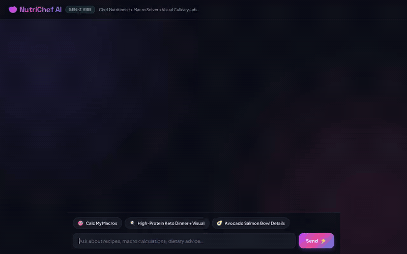

# 🥗 NutriChef AI

> **Personalized Culinary Chef & Nutrition Assistant** built with the Google Agent Development Kit (ADK), Agent Runtime, and Gemini.

NutriChef AI is an intelligent culinary and dietary coach that designs macro-balanced meals tailored to personal fitness goals, dietary restrictions, and allergies. It manages cross-session user memory, queries a curated recipe database, searches broad recipes, generates photorealistic culinary plating images, and renders structured UI directly via A2UI.

---

## 🎬 Live Agent Demo



---

## ⚡ What NutriChef AI Actually Does

Based directly on the implementation in [`app/agent.py`](app/agent.py) and [`agents-cli-manifest.yaml`](agents-cli-manifest.yaml), NutriChef AI provides:

### 1. 🧠 Long-Term Memory (Vertex AI Memory Bank)
- **Preload & Recall**: Uses `PreloadMemoryTool` to fetch past user context, dietary preferences, and allergies automatically at session start.
- **Auto-Extraction Callback**: Employs `generate_memories_callback` (`after_agent_callback`) to extract new user facts (e.g. dietary restrictions, favorite ingredients, target caloric goals) and persist them across conversations.

### 2. 🎯 Biometric & Macronutrient Calculation
- **Tool**: `calculate_macro_targets`
- Computes Basal Metabolic Rate (BMR) via the Mifflin-St Jeor equation and Total Daily Energy Expenditure (TDEE) based on activity level.
- Computes exact target splits for daily calories, protein (g), carbohydrates (g), and fats (g) based on fitness goals (*weight loss*, *maintenance*, *lean muscle gain*, or *ketogenic*).

### 3. 🍲 Curated Recipe Store (Google Cloud Firestore)
- **Tools**: `list_recipes`, `get_recipe_details`, `save_recipe`
- **Database**: Google Cloud Firestore collection `recipes`.
- Filters recipes by meal type (*dinner*, *lunch*, *breakfast*, *snack*) and dietary tags (*keto*, *ovo-vegetarian*, *high-protein*, *gluten-free*).
- Allows users to save customized recipe creations back into Firestore with nutritional profiles.

### 4. 🌐 Open-World Recipe Discovery (Google Custom Search API)
- **Tool**: `search_global_recipes`
- Queries the broader web for specialized culinary inspiration, ingredients, and cooking steps when recipes are not in the local database.

### 5. 📸 Photorealistic Culinary Plating Images (Imagen / Gemini Flash Image)
- **Tool**: `generate_dish_image`
- Uses `gemini-3.1-flash-lite-image` (`google-genai` SDK) to generate high-resolution, plated dish photography.
- Saves image bytes as an ADK session artifact (`tool_context.save_artifact`).
- Uploads image bytes to a public Google Cloud Storage bucket (`dishes/` prefix) and returns the public HTTPS URL for inline viewing.

### 6. 🎥 Short Culinary Video Generation (Google Gemini Omni)
- **Tool**: `generate_dish_video`
- Generates 4-second cinematic cooking and plating videos using Google's Omni model `gemini-omni-flash-preview` in the `global` region via the Interactions API.
- Saves video bytes as an ADK session artifact (`tool_context.save_artifact`).
- Uploads the video bytes to Google Cloud Storage (`videos/` prefix) and returns the public HTTPS URL.

### 7. 💻 Code Execution Sandbox
- **Feature**: `sandbox_code_executor` (`VertexAiCodeExecutor`)
- Executes Python code in a secure sandboxed environment to perform complex nutritional simulations and recipe scaling calculations.

### 8. 🎴 Dynamic Structured UI (A2UI v0.8)
- Employs `A2uiSchemaManager` (version 0.8) with the Basic Catalog (`Card`, `Column`, `Row`, `Text`, `Image`).
- `a2ui_callback` (`after_model_callback`) transforms valid A2UI JSON structures emitted by the model into structured UI data parts, rendering cards and dish visuals natively in the frontend.

---

## 🛠️ Google Cloud Services & Architecture

| Service | Role in NutriChef AI |
|---|---|
| **Vertex AI Agent Engine / Runtime** | Managed execution environment hosting the ADK agent over the A2A protocol. |
| **Vertex AI Memory Bank** | Managed cross-session long-term memory store for user dietary preferences and facts. |
| **Google Cloud Firestore** | NoSQL document database storing curated recipes, ingredients, instructions, and macros. |
| **Google Cloud Storage** | Object storage hosting generated culinary plating images and dish video assets. |
| **Vertex AI Code Execution Sandbox** | Secure execution sandbox for Python nutritional computing. |
| **Cloud Run** | Serverless hosting for the FastAPI proxy and modern Gen-Z chat frontend. |

---

## 🚀 Running Locally

### Prerequisites
- Python 3.11+
- `uv` package manager (`curl -LsSf https://astral.sh/uv/install.sh | sh`)
- Google Cloud CLI (`gcloud auth application-default login`)

### 1. Clone & Install Dependencies
```bash
cd nutrichef-agent
uv sync
```

### 2. Configure Environment Variables
Copy `.env.example` to `.env` and set your configuration:
```bash
cp .env.example .env
```
Ensure your Google Cloud Project ID and Storage bucket name are configured.

### 3. Launch the ADK Web Playground
To run the agent locally with the ADK developer UI and memory service:
```bash
uv run adk web . --port 8080 --reload_agents
```

### 4. Launch the Custom Frontend & Proxy
From the project root:
```bash
cd frontend
uv run python main.py
```
The frontend proxy will start and serve the chat interface locally.

---

## 📂 Repository Structure

```
nutrichef-agent/
├── app/
│   ├── agent.py               # Main ADK agent definition, tools, and callbacks
│   ├── a2ui_utils.py          # A2UI response processing callback & image sanitizer
│   ├── a2ui_prompt.txt        # Pre-baked A2UI v0.8 catalog schema and prompt instructions
│   └── memory_utils.py        # Vertex AI Memory Bank integration & extraction callback
├── frontend/
│   ├── main.py                # FastAPI proxy communicating via A2A protocol
│   ├── Dockerfile             # Container definition for Cloud Run
│   └── static/
│       └── index.html         # Gen-Z dark-mode chat UI with native A2UI card renderer
├── docs/
│   └── assets/
│       └── demo.gif           # Looping animated demo walkthrough
├── seed_firestore.py          # Seed script populating initial curated recipes in Firestore
├── agents-cli-manifest.yaml   # Agent Platform deployment manifest
└── pyproject.toml             # Python dependencies and project metadata
```
